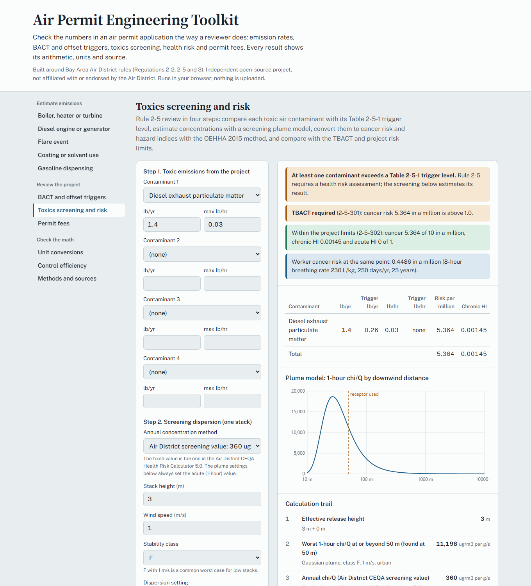

# Air Permit Engineering Toolkit

**Live tool: https://kouroshie.github.io/air-permit-toolkit/**

A free browser calculator for checking the numbers in an air permit application the way a reviewer does. It covers Bay Area Air District rules: emission rates, BACT and offset triggers (Regulation 2-2), toxic air contaminant screening and health risk (Regulation 2-5), and new-source fees (Regulation 3). Every result comes with its arithmetic trail, units and sources, so anyone can repeat the calculation by hand.



## What it calculates

| Calculator | What you get |
|---|---|
| Boiler, heater or turbine | lb/hr, maximum lb/day, ton/yr and CO2e from the firing rate and lb/MMBtu factors |
| Diesel engine or generator | The same from certified g/bhp-hr factors, with bhp, mechanical kW and electrical kW ratings; diesel PM against the Rule 2-5 trigger |
| Flare event | NOx, CO, SO2 from H2S, and VOC after destruction efficiency, from gas volume and composition |
| Coating or solvent use | VOC by mass balance with capture and control |
| Gasoline dispensing | Organic emissions from throughput with CARB EVR factors; benzene against its trigger |
| BACT and offset triggers | Collects the sources you add and checks 2-2-301 (10 lb/day) and the 2-2-302 and 2-2-303 offset thresholds for the whole facility |
| Toxics screening and risk | Table 2-5-1 trigger levels, screening concentration (Air District 360 ug/m3 per g/s factor or a Gaussian plume for the stack), OEHHA 2015 cancer risk, chronic and acute hazard index, TBACT and project limits |
| Permit fees | Regulation 3 Schedule B and Schedule D fees with minimums, maximums and surcharges (FY 2026-27) |
| Unit conversions | ppmvd to lb/MMBtu by EPA Method 19, oxygen correction, mg/m3 |
| Control efficiency | Capture times control, and devices in series |

Each calculator keeps its inputs in the page address, so a link reproduces the exact case. **Copy worksheet** puts the calculation trail on the clipboard for a memo or an engineering evaluation.

## How it relates to the Air District's own tools

The Air District publishes a 316-page Permit Handbook, separate Excel spreadsheets for single source categories, a CEQA Health Risk Calculator (Excel, 2022), screening maps and fee schedules. This toolkit links those steps in one place and shows every intermediate value. It reuses the Air District's published values where they exist (Table 2-5-1 toxicity values, the 360 ug/m3 per g/s screening factor, Regulation 3 fees). It is an independent open-source project, not affiliated with or endorsed by the Air District.

## Methods and verification

- [METHODS.md](METHODS.md) gives every equation, default and source.
- `node tests/verify.mjs` runs 48 checks against hand calculations and published values (Method 19, AP-42 examples, the Air District CEQA calculator's exposure factor, the Regulation 3 fee example).

## Limits

This is a screening and teaching tool. Rules and fees change, the dispersion screen is not AERMOD, and default emission factors are generic. Final permit decisions rest on the current rule text and an engineer's review.

## Run locally

No build step and no dependencies. Open `index.html`, or serve the folder:

```
python -m http.server 8000
```

## Files

- `index.html`, `style.css`: page
- `calc.js`: calculation engine (pure functions, also runs in Node)
- `data.js`: rule thresholds, toxicity values, fees and emission factors with sources
- `app.js`: interface and charts
- `tests/verify.mjs`: verification suite

## License

MIT. Built by Seyed Kourosh Mahjour, PhD. Companion to the [Petroleum Engineering Toolkit](https://kouroshie.github.io/petroleum-toolkit/).
